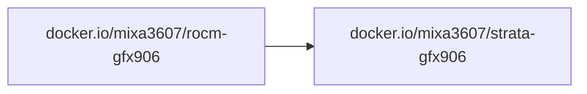

# Strata GFX906

Strata serves Qwen3.8-Flash-Next (and the Swift 1.5 fine-tune) from GGUF.
https://github.com/Niko1221/Strata

gfx906 (Instinct MI50 / MI60, Radeon VII / Pro VII) is wave64. Upstream builds
it only when asked: `-DSTRATA_HIP_GFX906=ON`. `setup.py` does not list that
architecture, so this image clones the upstream tag and applies
[`gfx906-setup.patch`](./build-context/patch/gfx906-setup.patch) before
compiling. hipBLASLt is not used; current ROCm does not ship a gfx906
hipBLASLt device library.

All images are built for the deprecated `gfx906` GPU architecture and are
**not** compatible with other AMD GPUs.

## Dependencies

The image is built on top of the [ROCm image](../rocm/README.md):



`Strata` is cloned from the upstream repo at build time (pinned to a git tag).
`llama.cpp` is downloaded from GitHub at the commit `setup.py` pins
(`LLAMA_CPP_COMMIT`). Neither tree is vendored in this repository.

## Prebuilt images

- [`docker.io/mixa3607/strata-gfx906:v0.1.41-rocm-7.14`](https://hub.docker.com/r/mixa3607/strata-gfx906/tags?name=v0.1.41-rocm-7.14)

The first published tag appears after the image build workflow runs.

## Run

The container needs the ROCm devices. On some boards the runtime will not
accept the card unless `HSA_OVERRIDE_GFX_VERSION=9.0.6` is set; the image sets
that by default. Two cards split one model with `GPUS`.

```bash
docker run --rm \
  --device=/dev/kfd --device=/dev/dri \
  --group-add video --group-add render \
  --ipc=host --ulimit memlock=-1 \
  -p 8080:8080 \
  -v strata-data:/data \
  -e MODEL=IQ2_XS \
  -e CONTEXT=32768 \
  -e GPUS=0,1 \
  docker.io/mixa3607/strata-gfx906:v0.1.41-rocm-7.14
```

[`docker-compose.example.yaml`](./docker-compose.example.yaml) is the two-card
`UD-Q4_K_XL` layout measured below. Point `./models` at the GGUF shards and
`./data` at a directory with room for the pack and the MTP draft, then:

```bash
export API_KEY="choose-a-secret"
export RENDER_GID="$(getent group render | cut -d: -f3)"
docker compose -f docker-compose.example.yaml up -d
```

The entry point is upstream `docker-entrypoint.sh`. Setup choices are its
environment variables: `FAMILY`, `MODEL`, `CONTEXT`, `VISION` (`no` | `yes` |
`cpu`), `KV`, `GPU`, `GPUS`, `LAYER_SPLIT`, `LOW_RAM`, `HOST`, `PORT`,
`API_KEY`, `GGUF_DIR`, `RESIDENT_BUDGET_GIB`, `KV_STREAMING`, `CONFIG`,
`REINSTALL`. The model files and the install config live on `/data`. The
engine is already in the image, so the first start does not recompile it.

With no NVIDIA GPU visible, setup selects the AMD backend by itself.

## Measured on 2x Radeon Pro VII

Strata `v0.1.41`, ROCm `7.14`, gfx906 engine (`STRATA_HIP_GFX906`, AVX2 CPU
experts). Figures below are from the running server's About and Monitor pages,
read while the model was loaded and the server was idle.

| | |
| --- | --- |
| Model | Qwen3.8-Flash-Next, Unsloth dynamic 4-bit (`UD-Q4_K_XL`) |
| Model id | `qwen3.8-flash-next-unsloth-ud-q4_k_xl` |
| Context length | 262,144 tokens (the monitor draws this as 256K) |
| KV cache | int8; 32,768 positions per layer kept in VRAM, the rest in RAM |
| Speculation | MTP drafts up to 3 tokens (min-p 0.50), prompt lookup on |
| Images | off |
| CPU | Intel Xeon E5-2686 v4 @ 2.30 GHz, 18 cores / 36 threads |
| Memory | 128 GB across 4 DIMMs, 1867 MHz (reported as DDR3); 113.0 / 126 GB in use while serving |
| GPU | 2x AMD Radeon Pro VII |
| Link | 1000 Mbps, full duplex, MTU 1500 |

`UD-Q4_K_XL` is Unsloth's dynamic 4-bit quant: a Q4_K mix with some layers kept
at higher precision. The server is configured for the full 262,144-token
window, and each request fills only the part it uses. The last completion
occupied 9.3K of that window (4%).

Loaded model, idle:

| | |
| --- | --- |
| Last completion | 5,988 prompt tokens, 3,328 output tokens, 34.3 tok/s decode, 220 tok/s prefill |
| VRAM | 31.8 / 32 GB (GPU 0 15.9 GB, GPU 1 16.0 GB) |
| Experts in VRAM | 6,463 experts, 18.9 GB |
| Context fill | 9.3K / 256K (4% of the 262,144-token window) |
| GPU temperature | 39°C and 36°C |
| Power | 32 W of a 380 W limit |
| GPU load | 0% |

Since Friday 18:59, 544 requests:

| | |
| --- | --- |
| Prompt tokens read | 835,293 at 209 tok/s |
| Prompt tokens reused | 37,519,778 |
| Output tokens | 539,073 at 23.7 tok/s |
| MTP drafts | 355,489 accepted of 464,295 offered (76.6%) |

The 23.7 tok/s figure is the decode average over the whole session. Recent
requests on the already-warm cache decode faster:

| Time | Prompt | Reused | Output | tok/s | VRAM hit rate | Duration |
| --- | ---: | ---: | ---: | ---: | --- | ---: |
| 10:11:58 | 5,988 | 0 | 3,328 | 34.3 | 92.1% + 2.1% PCIe | 124.2 s |
| 21:16:03 | 2,400 | 2,018 | 292 | 33.1 | 82.5% + 5.6% PCIe | 14.1 s |
| 21:15:57 | 2,023 | 1,820 | 53 | 27.8 | 75.1% + 8.0% PCIe | 6.4 s |
| 21:15:42 | 1,825 | 0 | 182 | 31.9 | 73.0% + 9.4% PCIe | 14.8 s |
| 21:14:51 | 1,842 | 1,460 | 284 | 29.8 | 72.1% + 8.9% PCIe | 15.3 s |
| 21:14:37 | 1,465 | 0 | 41 | 22.2 | 55.2% + 14.1% PCIe | 13.3 s |

On this host, a warm `UD-Q4_K_XL` request at a 256K context decodes at about
22–34 tok/s. The longest of these (5,988 prompt tokens, 3,328 output tokens,
no reused prefix) finished in 124.2 s at 34.3 tok/s, with 92.1% of expert
traffic served from VRAM. `pcie_frac` is 0.36, which is the PCIe share beside
the VRAM hit rate.

## Build from source

The build happens inside `docker buildx` on top of the ROCm base image
(`docker.io/mixa3607/rocm-gfx906:<rocm>-complete`) and produces the Strata image.
The Dockerfile clones Strata and, through `setup.py`, downloads llama.cpp.
Nothing is copied from a local source archive.

| Artifact | Script                      | Dockerfile                 |
| -------- | --------------------------- | -------------------------- |
| Image    | `./build-and-push.image.sh` | `./build-image.Dockerfile` |

### Prerequisites

- Docker with the `buildx` plugin
- Access to the ROCm base image (see the [rocm subproject](../rocm/README.md))

### Presets

Preset files set the Strata tag and the ROCm version. Source one, then run the
build script:

```bash
. preset.v0.1.41-rocm-7.14.sh
./build-and-push.image.sh
```

`gfx906-setup.patch` is written against Strata `v0.1.41`. `./upd2last-release.sh`
can write a preset for a newer tag; check that the patch still applies before
building it.

### Build variables

Defaults come from [`env.sh`](./env.sh) and [`../env.sh`](../env.sh) plus the
[rocm `env.sh`](../rocm/env.sh). Export any variable to override it.

| Variable              | Default                                  | Description                                  |
| --------------------- | ---------------------------------------- | -------------------------------------------- |
| `STRATA_IMAGE`        | `docker.io/mixa3607/strata-gfx906`       | Destination image name                       |
| `STRATA_ROCM_VERSION` | `7.14`                                   | ROCm version of the base image               |
| `STRATA_REPO`         | `https://github.com/Niko1221/Strata.git` | Strata git repository                        |
| `STRATA_BRANCH`       | `v0.1.41`                                | Strata git tag/branch to build               |
| `STRATA_COMMIT`       | _(empty)_                                | Pin a specific commit (on top of the branch) |
| `STRATA_PATCH`        | `gfx906-setup.patch`                     | Patch applied after clone; required for v0.1.41 |
| `STRATA_PRESET_NAME`  | `<branch>-rocm-<rocm>`                   | Name used in the image tag                   |
| `STRATA_IS_RELEASE`   | `0`                                      | `1` — full tags; otherwise `-pre` tag only   |
| `STRATA_PUSH`         | `1`                                      | Push the image to the registry               |
| `STRATA_FORCE_BUILD`  | _(unset)_                                | Set to `1` to rebuild even if the tag exists |
| `ROCM_ARCH`           | `gfx906`                                 | Target GPU architecture (from `../rocm/env.sh`) |
| `ROCM_IMAGE`          | `docker.io/mixa3607/rocm-gfx906`         | ROCm base image name (from `../rocm/env.sh`) |
| `REPO_GIT_REF`        | _(git tag, else short SHA)_              | Build revision appended to the tag           |

The base image is resolved as
`$ROCM_IMAGE:$STRATA_ROCM_VERSION-complete` (e.g. `docker.io/mixa3607/rocm-gfx906:7.14-complete`).

### Build the image

```bash
. preset.v0.1.41-rocm-7.14.sh
./build-and-push.image.sh
```

With `STRATA_IS_RELEASE=1` two tags are created:

- `$STRATA_IMAGE:$STRATA_PRESET_NAME-$REPO_GIT_REF` — pinned to the build revision
- `$STRATA_IMAGE:$STRATA_PRESET_NAME` — floating tag

Otherwise (`STRATA_IS_RELEASE=0`, default) only one pre-release tag is created:

- `$STRATA_IMAGE:$STRATA_PRESET_NAME-$REPO_GIT_REF-pre`

The build is skipped if the pinned tag is already in the registry, unless `STRATA_FORCE_BUILD=1`.

The build log is saved to `./logs/build_<timestamp>.log`.

### Push

Set `STRATA_PUSH=0` to keep the image local (no `--push` passed to buildx).

### Custom registry / local overrides

Example:

```bash
export STRATA_ROCM_VERSION=7.14
export STRATA_BRANCH=v0.1.41
export STRATA_IMAGE=registry.example.com/apps/strata-gfx906
export ROCM_IMAGE=registry.example.com/apps/rocm-gfx906
export STRATA_PUSH=0
./build-and-push.image.sh
```

See [`../.build/.env-local.sh`](../.build/.env-local.sh) for a ready-made local override file.
